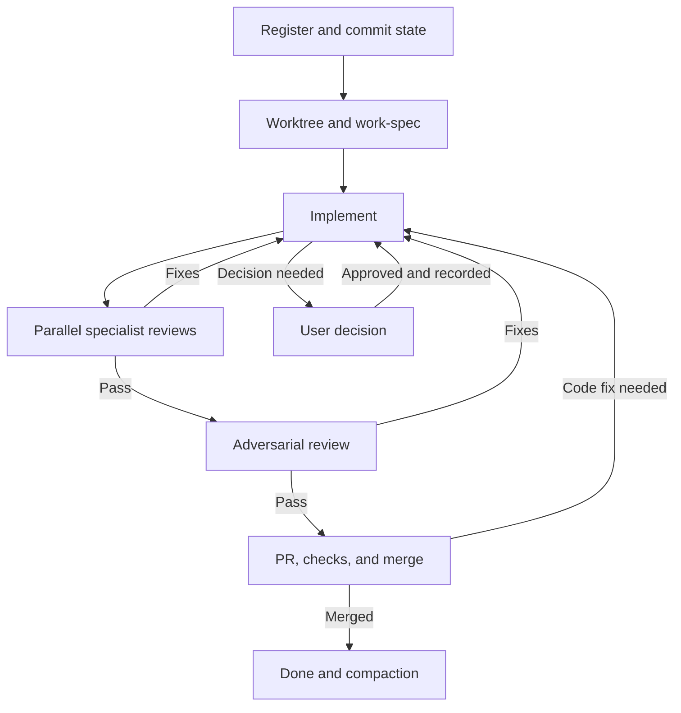

> Historical design note. Current behavior is owned by `assets/framework/`; CLI behavior and structure are in
> [interface.md](../cli/interface.md) and [architecture.md](../cli/architecture.md). Superseded passages below are
> retained as design history.

This is the v0.1 design candidate for a lightweight, prototype-led development framework. It preserves the agreed workflow, approval rules, sequential task starts, isolated parallel implementation, and compaction after merge. The concrete paths, state schema, report format, and initialization contract below are proposed defaults for this design review. Phase 1 defines the framework; Phase 2 packages it in a Go CLI. The reusable framework rules and the specifications of an individual application are separate. This full design note is a reference, not default context for every agent session.

# Language policy

Write all framework artifacts in English, including rules, documentation and specifications, skill definitions and templates, agent prompts and instructions, decision records, review reports, task summaries, dashboard labels, and framework-generated commit messages and PR descriptions. Record decisions from discussions in other languages in English.

# Delivery phases

| Phase | Deliverable | Completion condition |
| - | - | - |
| 1 — Framework definition | English rules, three skill contracts, agent responsibilities, context routing, work specification, state and report contracts, recovery and dashboard behavior. | The contracts form one coherent workflow and can be walked through with a small feature. |
| 2 — Go CLI | Versioned embedded framework core and extension catalog; an `init` command that installs the core and the chosen extensions in a new project and creates `refs/heads/workflow-state`; the `solomonar task` commands (rules section 7), the only state writers, with fact checks and the read-only `task status`; the `solomonar extension` commands that extend the core. | Initialization is repeatable, preserves project edits, and exposes the selected runtime's instructions correctly. Every `task` command validates and rejects as rules section 7 requires, with tests for transitions, fact checks, and the compare-and-swap retry. |

The CLI's first responsibility is project initialization and packaging, then the state commands the rules depend on; `solomonar doctor`, runtime adapters (hooks, skill installation, native agent files), and extension management follow them. For state, the CLI is a guard and an oracle, never a driver: it never runs sessions or calls model providers. Dashboard hosting is an implementation choice for Phase 2. No CLI, installed skills, dashboard application, or application architecture is implemented by this design note.

# Light core and extensions

The framework is a lightweight core of a process: a way of working, not a technology stack. The core holds only the minimal skills and agents that enforce the process; the CLI adds every other skill and agent as an extension.

| Part | Contains | Installed by |
| - | - | - |
| Core | `rules.md`, `report.md`, `reviewer.md`; skills `solomonar` (user entry point), `prototype`, `spec`, `work-spec`; agents `orchestrator`, `implementer`, `security-reviewer`, `correctness-reviewer`, `spec-reviewer`, `adversarial-reviewer`. | `solomonar init`; always present, never removed. |
| Extensions | Skills with the rules of a language, library, or practice, or a supporting procedure; agents that add a specialist reviewer. | `solomonar init` or `solomonar extension add`. |

- FW-1: An item belongs to the core only if the rules name it as a process step or a required role. Anything else is an extension.
- FW-2: The core is language-agnostic. No core rule, skill, or agent names a language, framework, or library; that knowledge lives in extension skills.
- FW-3: The process never depends on an extension. With no extension installed, every gate runs on the core reviewers.
- FW-4: Only the CLI installs and removes extensions. Adding or dropping a stack extension (language, architecture, frontend, backend, persistence, testing, operations) is an architecture or dependency decision and follows the approval loop.
- FW-5: The orchestrator names the installed extensions that apply to a change in each packet. Their `must` rules are approved global rules (authority order 2); installed extension agents join triage beside the core reviewers.

Verification: a project initialized with no extension can run the Phase 1 validation scenarios; `grep` of the core assets finds no language-, framework-, or library-specific rule.

Interface, catalog, store, and file ownership: [CLI v0.1 section 4.1 and section 4.3–4.6](../cli/interface.md#41-core-and-extensions).

# Agreed decisions

| Skill | Responsibility |
| - | - |
| `prototype` | Builds and updates a static HTML, CSS, and JavaScript prototype with sample data and testable flows. Asks necessary questions one at a time and supports product discovery through use. |
| `spec` | Extracts features and observable behavior from the prototype, then updates specifications based on intentional changes and user decisions. |

Project specifications live under `docs/`. Skills must be short, with minimal templates and questions tailored to the next step. Information is identified as observed in the prototype, agreed, or awaiting clarification.

`AGENTS.md` must specify which context to load for each type of work. Go is the user's primary language; it reaches a project as the `go` extension, never as core content (FW-2). This note records the skill designs; implementation and installation are separate steps.

Agreed flow: orchestrator → implementer → parallel specialist reviews → final adversarial review → pull request → merge into main. The implementer notifies the orchestrator when an architecture or dependency decision is needed, and the orchestrator requests user approval. The implementer waits for approval before applying the decision. Automatic completion through PR and merge depends on passing the required checks and following repository rules.

Parallel execution requirement: the user starts tasks one at a time. Each orchestrator reads state.json, registers its task, and commits the update before creating the worktree. The next task can start after registration is confirmed. Features are implemented in parallel, each in its own branch and worktree. Shared state shows what is planned, in progress, blocked, and completed; only orchestrators may modify it.

# Project and framework files

| Path | Responsibility |
| - | - |
| `AGENTS.md` | Mandatory short instructions and routes to the role, skill, and project context. |
| `docs/README.md` | Project mission, intended users, current objective, document index, and actual run/check commands when known. |
| `docs/specs/<capability>.md` | Current functional rules for an independently loadable area, including its UI behavior. |
| `docs/work/<id>-<slug>.md` | The active change's outcome, boundaries, acceptance criteria, and references. Removed from the current tree after merge and compaction. |
| `docs/architecture.md` | Approved structure, module boundaries, shared contracts, and structural constraints. |
| `docs/stack.md` | Approved technologies and dependencies, roles, and rationale. Manifests hold installed versions. |
| `docs/ui.md` | Shared layout and interaction rules plus relevant prototype references. |
| `docs/decisions.md` | Scoped decisions, rationale, pending choices, and links to the rules they affect. |
| `prototype/` | Static HTML, CSS, and JavaScript used for product discovery. |
| `docs/solomonar/rules.md` | Reusable orchestration, approval, review, state, and closure rules; identifies the framework version. |
| `docs/solomonar/agents/<role>.md` | One concise contract per core role (orchestrator, implementer, security, correctness, spec, adversarial) or installed extension agent. |
| `docs/solomonar/skills/<skill>/SKILL.md` | The procedure for a core skill (`solomonar`, `prototype`, `spec`, `work-spec`) or the rules of an installed extension skill; small templates live beside the skill and are loaded when needed. |

These are portable source locations. The selected runtime may need a small registration adapter; references alone do not register a skill. Application documents are created only when useful. The versioned registry is `state.json` on the dedicated `workflow-state` branch, described below.

Create files when there is useful information to put in them. A small project may start with a single file in `docs/specs/`. Split documents by responsibilities that are worth loading independently.

Specifications in `docs/specs/` describe the current agreed behavior or explicitly mark observations that have not yet been confirmed. Files in `docs/work/` describe requested changes. Update affected canonical documents as part of the change, before merge. Task compaction preserves the final task spec in Git history and replaces its state.json record with a short summary and references. Once cleanup is integrated, the full task document is no longer present in the current version.

# Context loading

The starting context consists of the applicable instructions, the assigned work spec, the documents and sections it references, and the affected code and tests.

The context list is a starting point. The agent expands it when it discovers a relevant dependency, shared contract, or security rule that may affect correctness. Mandatory global rules remain visible even for small tasks.

Consult the full prototype, the history of all tasks, and old reports when needed. Each rule has one primary document; tasks and other documents refer to it.

The use of short references and on-demand loading is also described in [Anthropic's guide to context engineering](https://www.anthropic.com/engineering/effective-context-engineering-for-ai-agents). The organization above is the proposed adaptation for this workflow.

## Example AGENTS.md instructions

```markdown
# Project instructions

- Write framework artifacts, reports, commit messages, and PR text in English.
- Load your assigned role from docs/solomonar/agents/.
- Load only the invoked skill, assigned work spec, relevant global rules,
  referenced documents, and affected code/tests. Expand for discovered dependencies.
- If no work spec exists, start from docs/README.md and the user's selected outcome.
- Orchestrators also load docs/solomonar/rules.md.

## Context routes
- Product behavior: docs/specs/<capability>.md.
- Structure/contracts: docs/architecture.md.
- Dependencies: docs/stack.md and manifests.
- UI: docs/ui.md, the relevant capability, and prototype flow.
- Approvals: relevant entries in docs/decisions.md.
- Execution state: refs/heads/workflow-state:state.json.
- History: the task's compact record; load spec_ref only for a concrete question.

## Mandatory rules
- Follow applicable user decisions, approved global rules, then the work spec.
  Escalate contradictions; preferences do not override requirements.
- New architecture decisions and dependency changes require user approval.
  Investigate first; report through the orchestrator; wait before applying.
- Only orchestrators write state.json. Serialize current read, update, and commit.
- Register and commit before creating a feature worktree.
- Modify code/specs only in the assigned worktree. Review a stable revision.
- The orchestrator delegates all stages and consolidates findings.
- Unresolved blockers, missing required reviews, or failed/unperformed required checks prevent advancement.
- Mark done only after confirmed merge into main.
- Update current project specs before merge; commit the final task spec separately.
- Compact through the documented closure rules and retain verifiable Git references.
```

The launcher must supply these root instructions to each session and delegated agent, then load the selected role and task references. Role contracts point to the common report contract; the orchestrator loads the complete workflow rules. A document index does not load its targets automatically. This design does not depend on a particular AI provider.

# The work-spec skill

Use `work-spec` as the v0.1 proposed name. It covers a feature, bug fix, refactor, or technical task. Its output is one change specification, not a complete description of the application.

`spec` maintains application specifications. `work-spec` prepares a selected change for implementation, based on relevant documents and the user's intent.

The skill reads existing context, clarifies only choices that affect the selected change, and writes one file in docs/work/. Keep sections short, reference shared rules instead of copying them, and omit optional sections with no useful content. It may run inside a newly reserved task's worktree before implementation begins.

## Minimal work spec template

```markdown
# W-001 — Change title
Status: In review

## Outcome and scope
<Authorized outcome, included behavior, and relevant boundaries.>

## Context
- <Current capability spec and relevant sections.>
- <Affected contracts/code, if they exist.>
- Prototype: <commit:path and flow, when relevant.>

## Acceptance criteria
- AC-1: <Observable condition and expected result.>
- AC-2: <Relevant failure or boundary case.>

## Constraints and checks
- <Applicable approved rule or dependency decision reference.>
- <Check for the criteria and any known verification limit.>

## Open questions
- <Only unresolved choices relevant to this work; mark blocking choices.>

## Implementation plan
- S-1: <type>(W-001): <intended checkpoint commit subject>
```

Requirements and context live in the work spec; execution state lives in the canonical committed state.json. Resolve active spec paths against the assigned feature worktree or its recorded Git revision, not the state checkout. After compaction, resolve spec_ref from Git history. Current product rules remain in the canonical project specifications.

## Prototype handoff and readiness

`prototype` begins with the smallest useful static flow and sample data. Ask at most the next necessary question; keep unrelated unknowns open. Record intentional prototype changes and retain a revision and flow reference for handoff.

`spec` distinguishes **Observed** behavior, **Agreed** requirements, and **Open** questions. A simulated backend action or a library used by a prototype does not approve the production architecture or a new dependency. An intentional approved change updates the relevant canonical rules; an accidental prototype or implementation defect does not redefine them.

Implementation is ready when the selected outcome is authorized, its scope is understandable, acceptance criteria are verifiable, relevant context is identified, and no unresolved decision prevents the chosen implementation. Existing instructions and approvals can satisfy this gate; do not add a ceremonial approval when the user has already authorized the work. Unknowns outside this scope remain open. The first executable task establishes the smallest runnable application baseline after any required architecture and dependency approvals.

# Agent roles

| Role | Responsibility |
| - | - |
| Task orchestrator | Exclusively claims the task in the shared registry, maintains its state, prepares context, delegates implementation and all reviews, consolidates findings, manages user approvals, and creates the PR and merges it once the conditions are met and it has the right to integrate. Multiple instances may coordinate different tasks in parallel. |
| Implementer | Implements the change according to approved specifications, runs relevant checks, and reports the outcome or blocker to the orchestrator. Waits for approval of new architecture decisions and dependency changes. |
| Specialist reviewers | Independently review the same revision in parallel and report findings to the orchestrator. |
| Final adversarial reviewer | Reviews the integrated functionality after specialist review and sends scenarios, evidence, and a proposed verdict to the orchestrator. |

An agent performs an activity; a skill provides its procedure. The agreed organization centralizes delegation in the orchestrator: the implementer and reviewers report results or blockers, and the orchestrator starts the next stage. The implementer receives one consolidated list of corrections, avoiding conflicting concurrent instructions.

When delegated work, each agent receives the objective, work spec, relevant references, and its area of responsibility. Transfer the full conversation history only when necessary. Reviewers also receive the exact diff or commit and the check results.

# Review specializations

The four core reviewers are language-agnostic (FW-2). Language, library, and practice rules reach a review only through the installed extension skills that the orchestrator names in the packet.

| Priority | Reviewer | Focus | Required when |
| - | - | - | - |
| 1 | Security (`security-reviewer`) | Bugs and security defects: crashes, error handling, resource leaks, concurrency and races, partial writes; authorization, data isolation, external input, files, secrets, other trust boundaries, and relevant dependency or configuration changes. | Every code change. |
| 2 | Correctness (`correctness-reviewer`) | Business logic: Agreed business rules (`<capability>/R-n`), domain invariants, calculations, state transitions, and the failure, boundary, empty, and permission cases those rules imply. | Every code change. |
| 3 | Spec (`spec-reviewer`) | Conformance: each acceptance criterion and the authorized scope of the work spec, omitted or extra behavior, `docs/architecture.md` and `docs/ui.md`, and the `must` rules (`<name>/C-n`) of every installed extension that applies, such as the rules of the language. | Every code change. |
| - | Adversarial (`adversarial-reviewer`) | The integrated feature as a whole (next section). | The risk tier requires it (rules section 6), after the specialists pass. |

- Priority applies after every code change. The three specialists still run in parallel on the same revision; they run in priority order only when the runtime cannot run them in parallel or their checks interfere. The orchestrator orders the consolidated correction list by priority, and when two corrections conflict, the higher-priority one is applied and the other re-examined. The authority order still decides between requirements; priority never overrides evidence.
- Language rules live in the language's extension skill, never in a reviewer. Choosing Go at `init` (or `solomonar extension add go`) installs `docs/solomonar/extensions/go/SKILL.md` (source: [`assets/extensions/language/go/`](../../assets/extensions/language/go/SKILL.md)) with rules `go/C-n`; the implementer follows them and the Spec reviewer checks every `must` rule.
- Spec checks that the change does what its written criteria and rules say. Correctness checks that the domain logic holds in every case those rules cover, including cases no AC names. The orchestrator deduplicates a defect both report.
- Language-specific checks and tools (for example `go vet` or `govulncheck`) are suggested by the extension that applies; a reviewer runs them when available and records any check not run.
- During triage, the orchestrator records which reviewers are required and why. A reviewer that does not apply is marked not required with a reason. An installed extension agent is required when its `applies_when` matches the change.
- A change in a language with no installed extension is still reviewed by all required core reviewers; the Spec reviewer records the missing language rules as a verification limit, not a PASS on them.

# Final adversarial review

The adversarial review takes place at the end, after the specialized reviews conducted in parallel. The proposed focus is the behavior of the feature as a whole: the reviewer looks for an input, a sequence of actions, or a failure condition that disproves the correctness of the integrated result.

## Proposed focus

| Area | What it checks |
| - | - |
| Component integration | Differences in contracts and assumptions across the UI, API, modules, databases, and jobs. Includes effects on existing features that use the same contracts. |
| Agreed invariants | Rules that must remain true in all relevant scenarios: data integrity, authorization, and operation uniqueness when required by the product. |
| Combinations of actions | Repeated actions, concurrent requests, steps executed in a different order, and state changes between two operations. |
| Partial failures | What remains after a timeout, cancellation, restart, or one operation succeeding followed by another failing; how the flow resumes or recovers. |
| Assumptions and evidence | Unverified assumptions that the implementer, tests, or reviewers may share; differences between the verified behavior and the required result. |

Specialized reviewers retain their responsibilities. The final stage prioritizes the connections between components and between steps in the flow. Any actual defect discovered may be reported, including one within a specialist's area.

Hypothetical examples: the HTTP response is lost after a contribution is saved and the client retries; the database update fails after a file is saved; the user's access is revoked between requesting an export and executing the job. The reviewer checks the complete result against the agreed policy.

If the necessary policy is missing or contradictory, the reviewer records the decision needed and the affected scenario. The reviewer does not turn a new feature or a preference into an implementation defect.

The emphasis on business rules, step order, concurrency, and assumptions is supported by [OWASP Business Logic Security](https://cheatsheetseries.owasp.org/cheatsheets/Business_Logic_Security_Cheat_Sheet.html) and [OWASP Testing for the Circumvention of Work Flows](https://owasp.org/www-project-web-security-testing-guide/latest/4-Web_Application_Security_Testing/10-Business_Logic_Testing/06-Testing_for_the_Circumvention_of_Work_Flows.html). Assigning these concerns to a final role is the proposal for this framework.

## Proposed context and execution

The reviewer receives the work spec, the relevant rules, the exact version of the integrated change, and access to the necessary code, contracts, and checks. The reviewer first forms independent hypotheses from the requirements and code, then consults summaries of earlier reviews to compare conclusions and avoid duplicates. Additional details are loaded only when the scenario being checked requires them.

The orchestrator starts this reviewer after the blocking findings from the specialized review have been closed. Following a fix prompted by adversarial review, the implementer and relevant specialists recheck the affected parts, then the final reviewer checks the fix and its effects on the new version.

The report remains compact: the version checked, the scenarios checked, findings with evidence, decisions needed, and verification limits. Any important check that was not run remains explicitly unverified.

A finding includes:

- the location;

- the conditions under which it occurs;

- the impact;

- evidence or reproduction steps;

- the violated criterion or rule, where applicable.

A reproduction test is useful when it checks an actual risk. If the environment does not allow execution, the reviewer explains the reasoning and the verification limit. Unconfirmed hypotheses are marked as such.

There is no minimum defect quota. Finding no confirmed defects within the reviewed scope is a valid result. Improvement suggestions are separated from defects that block completion.

Specialized reviewers report findings independently of the implementation author. The orchestrator removes duplicates, clarifies contradictions, and sends the necessary fixes to the implementer, then starts the final adversarial review in the agreed order. The verdict used at closure refers to the current integrated change; subsequent changes trigger rechecks of the affected parts.

The agreed rule for stopping loops without progress: after two consecutive rounds that leave the same blocker unchanged or reintroduce the same issue, the orchestrator stops repeating the loop, analyzes the cause, and presents the blocker and options to the user. Reaching the threshold does not constitute acceptance of the change.

# Priorities and arbitration between reviewers

The agreed priority is based on approved requirements and impact. Reviewers may have different interpretations; the orchestrator must produce a single consolidated result with verifiable justifications.

## Authority of rules

| Order | Source | Agreed rule |
| - | - | - |
| 1 | The user's explicit and applicable decision | Establishes or changes a requirement; it is recorded with the subject and limits of the approval. |
| 2 | Approved global specs and mandatory rules | Define shared behavior, architecture, security, and technical constraints. |
| 3 | The approved work spec | Specifies the change within the global rules. A deviation requires an explicit decision and updates to the affected documents. |
| 4 | General recommendations from agents | Apply when compatible with the approved rules and supported by a concrete benefit. Preferences remain suggestions. |

Two approved requirements that contradict each other require a decision. The orchestrator also flags conflicts between the global spec and the work spec; it does not silently omit an acceptance criterion. The code and prototype are evidence of existing behavior and do not automatically change approved requirements.

## Handling findings

| Situation | Action |
| - | - |
| Demonstrated defect or violation of a mandatory criterion | Fix before completion. |
| Style or organization recommendation without a violated rule | Non-blocking suggestion. |
| Technical disagreement about whether a defect exists | The orchestrator requests a reproduction, a relevant test, or a precise analysis and records the conclusion. |
| Contradictory requirements or an unclear product choice | Request a user decision. |
| The fix requires a new architecture or dependency decision | Request approval before applying it. |
| An important check was not run or a reviewer produced no result | The stage is incomplete; it is not a PASS. |

Severity determines the urgency of fixes according to impact, such as unauthorized access, data loss, or a blocked essential flow. Whether a finding is blocking depends on the violated rule and the acceptance conditions. The specialization label and the number of reviewers who agree do not override valid evidence. The adversarial reviewer uses the same arbitration rules.

Example: a reviewer recommends an in-memory store, but the spec requires sessions to survive a restart. The orchestrator rejects the incompatible recommendation and requests a compliant implementation. If the solution requires a new dependency, the orchestrator requests approval. If two approved policies simultaneously require a permanent public link and access revocation for the same document, the user clarifies the policy before work continues.

Each finding receives an ID and retains the revision checked, the affected rule or criterion, the impact, the evidence, and the resolution. The implementer receives the relevant open findings and a single set of actions. Rejecting a finding requires justification supported by evidence.

# Execution loop and approvals

## Agreed main flow

1. After registration and worktree setup, the orchestrator prepares or validates the work spec, checks readiness, and assigns the approved outcome and relevant context to an implementer.

2. The implementer executes the change, updates the specs affected by approved decisions, and runs the relevant checks.

3. When the candidate is ready, the implementer reports the revision and results to the orchestrator.

4. The orchestrator starts the specialized reviewers in parallel on the same revision of the code and specs and waits for the required results.

5. The orchestrator consolidates the findings. Fixes return to the implementer; after remediation, the affected checks and reviews are repeated.

6. When the specialized review is complete with no blockers, the orchestrator starts the final adversarial reviewer.

7. Adversarial findings enter the same correction loop; remediation is followed by the relevant specialists and an adversarial recheck.

8. Once the candidate is accepted, the orchestrator creates the PR, monitors the required checks and integration with main, then merges when all conditions are met.

The candidate code and specs remain stable while a review set runs. Reviewers do not modify tracked files; reproduction work uses temporary locations and isolated test data when needed. Checks that interfere with each other run sequentially. A changed candidate requires a new revision and an explicit assessment of affected checks. Reuse unaffected evidence only with the original revision and a recorded reason; an earlier PASS never automatically covers new code.

## Task flow

The orchestrator owns the transitions and consolidates every report. Decision requests from any stage follow the same user-approval loop.



## Human approval loop

Any new architectural decision or dependency change requires user approval, including when a reviewer proposes it as a fix. Applying an already approved decision within its limits can continue without requesting approval again.

The agent that identifies the need prepares the question, the recommended option, relevant alternatives, the impact, and the work that is blocked. It may investigate and prepare the proposal; applying the choice waits for approval.

The orchestrator records a scoped decision ID, sets a decision blocker and the next action for the user, and presents the question, recommended option, alternatives, and impact. If no independent work can continue, status becomes blocked. No response is not approval. Upon approval, record its scope in docs/decisions.md, update the affected specs, clear the blocker, and resume the dependent work. If rejected, prepare a revised option.

The affected work and dependent work remain on hold. Independent work may continue. The agent saves a checkpoint, and execution resumes on the approval event, without repeated questions or automatic retry loops.

## Where the process returns

| Trigger | Return point | Condition for resuming |
| - | - | - |
| An architecture or dependency decision, or a conflict between requirements | The user, through the orchestrator | Decision recorded and documents updated. |
| A defect in specialized review | The implementer, through the orchestrator | Fix and relevant reviews completed on the new revision. |
| A defect in adversarial review | The implementer, through the orchestrator | Fix, affected specialized checks, and adversarial reassessment. |
| Integration or CI failure after the PR is opened | Diagnosis through the orchestrator; the implementer if code changes are needed | Relevant checks passed on the current candidate. |
| Lack of progress | Reassessment through the orchestrator and, if a blocker remains, the user | Cause clarified or an explicit decision; no automatic acceptance. |

A temporary infrastructure error is diagnosed and may be retried without arbitrary code changes. A fix after the PR is opened updates the same PR and goes through the relevant checks.

# Conditions for PR and merge

The requested workflow policy allows the orchestrator to create the PR and merge automatically after the stages pass. An additional human confirmation for merging is not introduced by default; approvals required by the repository remain mandatory.

Before merging, verify that the mandatory criteria are met; the affected specs reflect approved decisions; the required reviews are complete and valid for the current candidate; there are no blocking defects or open decisions; the mandatory checks and integration with main have succeeded; and the repository rules are satisfied.

Agent verdicts must be tied to the revision checked and exposed as verifiable workflow results. An informal approval message does not replace CI checks or repository rules. If main changes in a relevant way or the candidate is modified, integration and the affected reviews are checked again.

The [GitHub documentation on protected branches](https://docs.github.com/en/repositories/configuring-branches-and-merges-in-your-repository/managing-protected-branches/about-protected-branches) describes required checks, approvals that can become stale after changes, and automatic merging when conditions are met. The actual configuration of these mechanisms belongs to the future implementation of the framework.

# Parallel execution and shared state

Sequential starts, parallel execution. The user starts task 1, waits for registration and the commit updating state.json, then starts task 2. The first version focuses on isolating feature work. We assume sessions run on the same machine, using worktrees of the same local repository.

## Organization

Each feature has a responsible orchestrator, its own branch, and its own worktree. The implementer and reviewers are assigned that feature's worktree. Reviewers inspect the same stable revision; implementation resumes if fixes are needed.

The agreed requirement is one versioned registry shared by all orchestrators. The concrete v0.1 proposal uses a dedicated workflow-state branch and one persistent coordination checkout containing state.json. This refines the earlier main-checkout location: product code and docs remain on main and feature branches, while progress commits remain on workflow-state, which is never merged into main. All readers use the committed registry at refs/heads/workflow-state.json; feature-local copies are not coordination sources.

| Illustrative directory | Role |
| - | - |
| `/projects/app/` | Main code checkout and current project documents. |
| `/projects/app-state/` | Persistent `workflow-state` checkout; canonical registry writes. |
| `/projects/app-worktrees/W-001/` | `feature/W-001`; isolated task specification, implementation, and review. |
| `/projects/app-worktrees/W-002/` | `feature/W-002`; independent parallel work. |

The coordination checkout is prepared once during bootstrap. The registration-before-worktree rule applies to each feature worktree.

## Starting a task

1. The orchestrator reads the committed registry and the selected task brief or existing spec. It checks ownership and dependencies. A complete work spec is not required to reserve a task.

2. It records a unique task ID, title, owner, reserved status, setup stage, planned branch/worktree, and next action, then commits state.json in the coordination checkout.

3. Successful local commit is the registration barrier. The orchestrator confirms it, and the user may start the next task. A remote push is not required for this same-clone coordination model.

4. It creates the feature branch and worktree from the intended current main revision. If a prerequisite merged remotely, fetch or update the code baseline and verify that the starting revision contains its recorded merge_commit.

5. It marks the task running in specification, creates or refines the work spec in that worktree, and records it separately in Git. After readiness, it advances to implementation and delegates the work. Independent tasks continue in parallel.

If registration or the commit fails, the worktree is not created. If worktree setup fails later, the task remains registered, with the blocker reported.

## Feature isolation

Git worktree provides separate working directories and indexes within the same repository. Unmerged changes to feature 1 do not change feature 2's working files. Each team modifies only its assigned worktree.

If applications or tests use shared services, each feature gets separate ports and test data as needed. A worktree does not automatically isolate databases or external services. Features can modify the same file on different branches; compatibility is checked during integration. For the first version, a task that needs another task's code waits until that code is merged into main.

## State, dashboard, and integration

Only orchestrators update state.json, each for its own task except an explicit ownership handoff. Every write serializes the current read, owner/transition validation, update, and commit in the coordination checkout. A short local serialization mechanism is sufficient; no lock is held during implementation, review, or a user wait. On failure, report and resolve any uncommitted registry change before another writer proceeds; consumers read the last successful commit.

Commit changes to stage, status, agent assignment, blockers, decisions, and next action. Git history is the transition history; do not duplicate an event log inside state.json. Push workflow-state to a configured remote when available and expose publication failures, while the local branch remains canonical in v0.1. Do not force-push or merge registry commits into main. Multiple independently writable clones are outside this version's coordination contract.

The orchestrator remains responsible, and the task keeps its worktree while waiting for approval. New architecture and dependency decisions follow the user approval process already agreed. Merges happen one at a time, checking compatibility with main and rechecking the parts affected by integration. A task becomes done once the merge is confirmed.

## Active state record

Proposed v0.1 contract. The example is illustrative, not a report of an executed task. Use actual full commit SHAs, real links, and RFC 3339 UTC timestamps in execution.

```json
{
  "schema_version": 1,
  "tasks": {
    "W-001": {
      "title": "Login",
      "spec": "docs/work/W-001-login.md",
      "owner": "orch-01",
      "status": "running",
      "stage": "implementation",
      "branch": "feature/W-001",
      "worktree": "/projects/app-worktrees/W-001",
      "revision": "<FULL_CANDIDATE_SHA>",
      "active_agents": [{"id": "impl-01", "role": "implementer"}],
      "blockers": [],
      "next_action": {"actor": "impl-01", "action": "Implement AC-1"},
      "updated_at": "2026-10-20T15:00:00Z",
      "pr": null
    }
  }
}
```

Technical references: [git worktree](https://git-scm.com/docs/git-worktree) describes separate working trees within one repository; [GitHub merge rules](https://docs.github.com/en/repositories/configuring-branches-and-merges-in-your-repository/managing-protected-branches/about-protected-branches) describe repository merge conditions. The dedicated registry branch is this framework's proposed implementation choice.

# Task compaction after merge

A task is done once its merge is confirmed. Compaction is an automatic administrative closeout step coordinated by the same orchestrator. The goal is to keep current documentation easy to search while making the details of completed tasks available on demand.

## What we keep in the current version

Current rules, architecture, stack, and relevant decisions remain in canonical docs. Specs for active tasks or tasks awaiting compaction remain in docs/work/. A compact record retains status, completion stage, one-sentence outcome, spec_ref, merge_commit, PR, and updated_at. It does not need an extra summary file or archive folder.

The historical spec preserves the requirements and decisions agreed for that change. It does not automatically become the current rule for future tasks. Reports or conversations not recorded in Git are not automatically archived through the spec reference.

## The final spec commit

The latest agreed version of the spec gets a dedicated commit, for example spec(W-001): finalize task specification, containing only the task document. This commit must match the spec used for final validation. If approved changes follow, the new version is saved and the reference updated; requirements are not rewritten just to match implementation omissions.

For the first version, integration uses a merge commit, preserving the task's commits. The final reference is set after any necessary rebase, and main's history is preserved. Squash does not preserve the identity of the separate commit in the resulting history. A SHA recorded in JSON does not replace keeping the commit in accessible Git history.

## Closing the task

1. Before merging, the affected canonical documents reflect the approved changes, and the final spec has its dedicated commit.

2. After confirming the feature merge, the orchestrator records status done, stage compaction, and the actual merge_commit. Dependent features may now use that merged implementation once their local baseline contains it.

3. It verifies that spec_ref opens the final document and that the commit is part of main's history.

4. It prepares a small documentation cleanup PR from current main that removes the full file from docs/work/ and fixes references. Use the same task ID; cleanup does not create another work spec or a recursive feature lifecycle. The commit can be docs(W-001): compact completed task. Relevant documentation checks and repository rules apply.

5. After cleanup merges, the orchestrator sets stage complete and keeps the compact record. Earlier agents, worktree paths, and intermediate state remain in registry history. Worktree deletion is a separate deliberate cleanup after confirming that no uncommitted or unmerged work would be lost.

A failed cleanup leaves status done and stage compaction, with an administrative blocker and next action. It does not revert the feature to blocked or prevent dependent features from using already-merged code. Keep the full spec until cleanup succeeds. Compaction is an orchestrator rule, not a separate v0.1 skill.

## Proposed compact record

Illustrative example. Actual execution uses full SHAs and the task's real references.

```json
{
  "schema_version": 1,
  "tasks": {
    "W-001": {
      "status": "done",
      "stage": "complete",
      "summary": "Login and logout with server-side sessions.",
      "spec_ref": "<SHA_SPEC>:docs/work/W-001-login.md",
      "merge_commit": "<SHA_MERGE>",
      "pr": 42,
      "updated_at": "2026-10-20T17:00:00Z"
    }
  }
}
```

An agent reads this record first, then loads the historical document only for a specific question, such as a regression or the reason for a decision. The command is git show "\<spec_ref>", using the actual value from state.json. The summary helps select the relevant task; the full details remain in Git.

Technical references: [git merge](https://git-scm.com/docs/git-merge) for history preservation and squash behavior; [gitrevisions](https://git-scm.com/docs/gitrevisions) for commit syntax; [git gc](https://git-scm.com/docs/git-gc) for retaining objects reachable from Git references.

# State semantics

Status describes whether work can proceed; stage identifies the current part of the workflow. Agent assignments are the last reported assignments, not proof of process liveness. The task ID is stable throughout reservation, implementation, merge, and administrative compaction.

| Status | Meaning |
| - | - |
| `planned` | Selected future work without an execution owner. |
| `reserved` | An orchestrator owns the task; branch/worktree values may still be planned. |
| `running` | The task is actively progressing, including specification or corrections. |
| `blocked` | The next meaningful progress requires an unresolved decision, dependency, check, or environment condition. |
| `paused` | Execution was deliberately stopped while preserving the task and its work. |
| `cancelled` | Work ended without feature completion; it is not done. |
| `done` | The feature merge into main was confirmed. Compaction may still be pending. |

Stages are `setup`, `specification`, `implementation`, `specialized_review`, `adversarial_review`, `integration`, `compaction`, and `complete`. Integration includes PR, required CI, compatibility with main, and merge. Preserve the current stage while blocked or paused.

Normal progression is planned/reserved → running → done. Reservation may be created directly from a user brief. Before done, work may pause or block, then resume its appropriate stage. A cancelled task resumes only by explicit user instruction after inspecting the preserved work. A merged task keeps done; a regression or revert is a new linked task. Corrections return to implementation and the affected reviews without allocating a new task ID.

Before reservation, only a title, status, and timestamp are needed. Reservation adds owner, planned branch/worktree, setup stage, and next action. `spec` and `revision` may be absent during setup; the spec must exist before implementation and the exact candidate revision is required for review. `revision` identifies the latest reported committed code/spec candidate, not uncommitted changes. Optional fields include `depends_on`, `related_task`, `session_ref`, `cleanup_pr`, and evidence references. Omit empty optional fields; keep the common meanings stable.

Each blocker has `id`, `kind`, `summary`, and an optional `ref`. Kinds are `decision`, `dependency`, `check`, and `environment`. IDs are stable within the task. `next_action` names the responsible actor and the concrete next step, for example `{"actor":"user","action":"Decide W-001/D-1: session storage"}`. A decision blocker prevents its dependent work; independent authorized work may continue.

Only a confirmed merge allows done. After that, a cleanup problem remains an administrative blocker at stage compaction. Successful cleanup advances to complete and permits the compact record. A failed review, missing check, or cancelled task never counts as completion.

# Agent reports and verification

Use one concise report contract across agents. Omit empty optional sections. Findings carry evidence and a rule or acceptance criterion, rather than a mandatory issue count.

```markdown
# <Task ID> — <Role>
Revision: <exact candidate commit>
Result: <result defined below>

## Summary
<Outcome or review conclusion.>

## Checks and evidence
- <Criterion/scenario; check performed; result; evidence reference.>

## Findings
- <ID; blocking/suggestion/unverified; location; conditions; impact;
  violated rule/AC; evidence; required correction.>

## Decision needed
- <ID; question; recommended option; alternatives; impact;
  work awaiting the decision.>

## Next action
<Responsible actor and action, if work remains.>
```

| Result | Interpretation |
| - | - |
| `READY_FOR_REVIEW` | Implementer handoff; it does not approve the change. |
| `PASS` | Reviewer completed the assigned scope with no unresolved blocking finding or required verification gap. |
| `CHANGES_REQUIRED` | Confirmed blocking findings return to the implementer through the orchestrator. |
| `NEEDS_DECISION` | A user decision is required before dependent work can proceed. |
| `INCOMPLETE` | Required evidence or review execution is missing; diagnose or complete it. |

The orchestrator records which specialties apply and why. An inapplicable specialty is marked not required with a reason; it receives no fabricated PASS. Every required reviewer must produce a valid PASS before the stage advances. The adversarial review follows the specialized review. Findings are deduplicated into stable task-scoped IDs, with their evidence and resolution.

Keep final durable evidence in a short **Verification** section of the feature PR:

```markdown
## Verification
- Task: W-001
- Candidate: <full SHA>; integration baseline: <main SHA or integrated candidate>
- Final specification: <spec commit:path>
- Acceptance: <AC IDs, outcomes, and evidence>
- Checks: <commands/scenarios actually run and results>
- Reviews: <required specialist and adversarial verdicts, revisions, report references>
- Decisions: <scoped approval references relevant to the change>
- Limits: <unverified behavior or environment limitations, if any>
```

Before a PR exists, reports may remain in the active session. If needed reports are lost on resume and no durable reference exists, treat them as unverified and repeat the relevant verification. A spec_ref archives the specification, not an unrecorded conversation. Before compaction, preserve the final verification in the PR and ensure its reference is in state.

An important unperformed required check prevents advancement. Establish meaningful checks from the acceptance criteria and affected areas; do not add tests that merely repeat trivial implementation details. Record pre-existing failures separately from regressions introduced by the task.

# Bootstrap and recovery

Bootstrap starts from a short project objective and the next useful prototype flow. The project brief and index may exist before architecture, dependencies, layout, and full functionality are known. Create those documents as decisions become useful.

Record real startup, build, test, and lint commands in docs/README.md when the project becomes executable. Before changing existing code, note the relevant baseline and known failures. An unknown command is recorded as not established, not replaced with a guessed successful result. Before the first managed task, prepare the local Git baseline, registry branch, and coordination checkout. Integration requires an available remote/PR path and compliance with its rules; missing access is reported as a concrete blocker when it prevents progress.

The runtime must support an explicit working directory, selective file loading, execution of relevant commands, isolated delegation with a task/revision, result collection, and pausing for a user decision. Where supported, reviewers receive read-only access to tracked code and specs. The framework's ownership rules are behavioral contracts; a Git worktree is not a security boundary. Provider registration and permission enforcement belong to the selected runtime integration.

| Event | Orchestrator behavior |
| - | - |
| Pause | Stop new delegation, settle or stop active work, and commit status paused with the stage, latest committed revision, outstanding work, and next action. Preserve uncommitted changes. |
| Unexpected session end | The recorded state may be old. On resume, inspect actual Git/worktree/PR state before declaring an agent active or restarting a step. |
| Resume | Read the canonical record, inspect the branch, worktree, dirty files, checks, decisions, and PR. Reconcile completed actions and continue the same task; do not create duplicate worktrees or PRs. |
| Ownership handoff | Stop or confirm the previous execution has stopped, explicitly assign the new orchestrator, and commit the ownership change before it writes further task state. |
| Cancel | Stop execution and set cancelled with the reason and remaining work. Keep branches and dirty files until their disposition is explicit. |
| Regression or revert after merge | Create a new related task. Preserve the original done record and its historical spec and merge references. |

Pause and cancellation change the status of unmerged work. If only administrative compaction is paused, cancelled, or blocked, retain status done and record the remaining administrative action.

A checkpoint is the task's small state record plus its existing worktree and Git history. A brief note of uncommitted work may be included in the next action; do not store full logs or secrets in state. User approvals persist within their recorded scope. No time-based ownership takeover, heartbeat service, or automatic destructive cleanup is required.

Record decisions in English with a task-scoped ID, question, status, selected option when approved, scope, rationale, date, and relevant references. Reuse an approved decision only within that scope. If a later decision supersedes it, identify the replacement and update the applicable canonical rules.

# Live HTML dashboard contract

The first dashboard is a read-only view of the committed registry. A local serving adapter reads `refs/heads/workflow-state:state.json` and supplies JSON to the page. The proposed refresh interval is five seconds. Static HTML alone is not responsible for running Git; hosting and the adapter are implementation work for Phase 2.

| View | Content |
| - | - |
| Task list | Task ID/title or compact summary, status, stage, owner, next actor/action, and last recorded update. |
| Task detail | Last reported agent IDs/roles, blockers, decisions, active spec or historical spec_ref, revision, PR, and evidence references. |
| Needs your decision | Tasks with a decision blocker, showing the question, recommendation, impact, and responsible orchestrator. |
| Data freshness | Last successful registry read, source commit, task updated_at, and any read/publication error. |

Approval happens in the orchestrator conversation. The dashboard points to the task/session when a runtime provides a link; it does not grant approval or mutate state. A task with an old update is shown as last reported at that time, not confidently alive or dead. Do not introduce heartbeats to manufacture precision. Read recommendation and impact from the referenced decision entry when the user opens it; keep the registry's blocker summary short.

Resolve active spec links against the feature revision/worktree. Resolve completed specs through spec_ref only when requested. Load detailed history and reports on demand. The roadmap is a filtered view of the same registry, not a separately maintained source of progress.

# Phase 2: Go initialization contract

The future Go CLI embeds the framework core (rules, the three core skills and their templates, the core agent contracts, the AGENTS.md template, and an empty registry template) and a catalog of extensions. The application's mission and business rules remain editable project content. An embedded global framework spec or extension does not pre-approve a project's architecture, production dependencies, or application behavior; installing a stack extension records its decision (FW-4).

`init` is expected to:

1. Establish the project location and use the existing authorized project brief, or start with one short objective.

2. Materialize the versioned core, the extensions the user selects (none when the stack is not decided yet), root AGENTS.md, and minimal docs/README.md. Later extensions are added with `solomonar extension add`.

3. Prepare the empty committed registry on workflow-state and its persistent coordination checkout once Git setup is valid.

4. Register or document how the chosen runtime loads the instructions and skills, then report the next useful action: start the prototype.

Repeated init preserves existing project decisions, specs, state, and customized files. Identical initialization should be a no-op; differing managed assets produce a clear conflict instead of a silent overwrite. Framework upgrades are a separate intentional operation. Optional application documents are created progressively.

Go's [embed package](https://pkg.go.dev/embed) can include a file tree in a binary through embed.FS, whose embedded contents are read-only. Initialization copies templates into the project so that the project files can evolve normally. This packaging capability does not by itself execute agents or implement a live dashboard.

# Phase 1 validation

Use a small flow to walk through the contracts before implementing the CLI:

| Scenario | Expected trace |
| - | - |
| A static flow becomes selected work | Observed prototype behavior → agreed criteria → reserved record committed → feature worktree → work-spec → readiness. |
| Implementation needs an unapproved dependency | Decision report → orchestrator records blocker and next action for user → scoped approval → docs updated → work resumes. |
| A reviewer proves a defect | Consolidated finding → fix → affected checks/reviews on the new revision → adversarial review. |
| The feature merges | Merge verified → done with compaction pending → historical spec verified → cleanup PR → compact complete record. |
| The orchestrator restarts after merge | Inspect the actual PR/merge first → reconcile state → continue compaction without reimplementing the feature. |

These scenarios define the reviewable v0.1 behavior. A real pilot can adjust concrete defaults based on evidence without adding new layers in advance.

# Proposed name

**VARNU** — a short working-name proposal, pronounced “var-noo.”

**From intent to verified code.**

The planned CLI form is `varnu init`. The name is a proposal, not an accepted product identity.

# Amendment: Git checkpoint task recovery (2026-10-23)

This amendment supersedes the statements above that the registry is one `state.json`, that the worktree path is
never stored, and that the work spec holds no plan. The contract is in
the interface (sections 8.6 and 8.7, UC-25 and UC-26).

- The registry stores one file per task (`tasks/<ID>.json`) beside `state.json`, which keeps only the schema
  version. A record past setup holds its immutable `base`, its worktree path relative to the main checkout, and
  whether its current owner confirmed it.
- The work spec carries `Status: In review | Approved` below the title and an implementation plan whose steps
  are the intended commit subjects. The user approves the plan before implementation; the orchestrator records and
  commits that approval, and alone edits the plan.
- The implementer commits each step as a checkpoint with the planned subject and a `Step: <ID>/S-<n>` trailer.
  Progress lives only in those commits. `task status` reconciles steps with commits; the CLI rejects
  implementation without an approved plan and review without a clean, fully checkpointed candidate.
- A new session takes a task through `task handoff`, inspects it, and runs `task confirm` before any stage
  change; it delegates only the remaining steps. Reviews still run on one stable cumulative candidate.

# Amendment: runtime commands without hooks (2026-10-24)

This amendment narrows the statement above that runtime adapters arrive with hooks. Runtime management is delivered
as `solomonar runtime list|add|remove` alone
([interface UC-5](../cli/interface.md#uc-5-add-list-or-remove-a-runtime) and CLI-D36,
[architecture section 12](../cli/architecture.md#12-implementation-plan)); guard hooks, their installation, and
their removal stay deferred to `guard`. The commands are implemented: they add, update, or remove one runtime's
adapter files and manifest choice after `init`, and never write a hook, runtime settings, or the registry. Live
runtime acceptance stays separate evidence.
